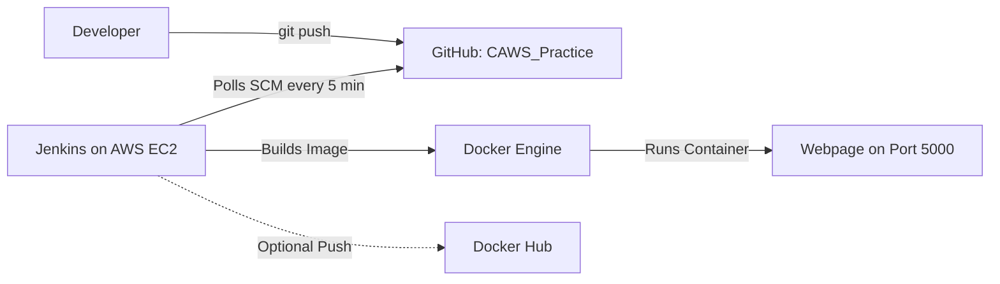

# 🚀 Complete Guide: AWS EC2 + Git + Docker + Jenkins CI/CD Pipeline

This guide walks you through setting up an automated CI/CD pipeline on AWS that checks your GitHub repository every **5 minutes** for updates, builds the Docker container, and deploys it automatically.

---

## 📋 Architecture Overview



---

## Step 1: Launch an AWS EC2 Instance

1. Open the [AWS EC2 Console](https://console.aws.amazon.com/ec2).
2. Click **Launch Instance** and configure:
   - **Name**: `Jenkins-CI-CD-Server`
   - **AMI**: `Ubuntu Server 24.04 LTS` or `Ubuntu Server 22.04 LTS` (64-bit x86)
   - **Instance Type**: `t2.medium` or `t3.medium` *(Recommended: 2 vCPUs, 4GB RAM to smoothly run Jenkins + Docker)*
   - **Key Pair**: Select your existing key pair or create a new `.pem` key.
   - **Storage**: Minimum `20 GB` gp3.

### 🛡️ Configure Security Group (Inbound Rules)
Add the following inbound rules:

| Type | Protocol | Port Range | Source | Purpose |
| :--- | :--- | :--- | :--- | :--- |
| **SSH** | TCP | `22` | `My IP` | SSH access into EC2 |
| **Custom TCP** | TCP | `8080` | `0.0.0.0/0` | Jenkins Web Dashboard |
| **Custom TCP** | TCP | `5000` | `0.0.0.0/0` | Live Web Application |

Click **Launch Instance**.

---

## Step 2: Connect to EC2 and Run Automated Setup

1. Connect to your instance via SSH:
   ```bash
   ssh -i /path/to/your-key.pem ubuntu@<YOUR_EC2_PUBLIC_IP>
   ```

2. Download and run the automated setup script from your repository:
   ```bash
   curl -fsSL https://raw.githubusercontent.com/SudeepReddyEaga/CAWS_Practice/main/setup_aws_ec2.sh -o setup_aws_ec2.sh
   chmod +x setup_aws_ec2.sh
   ./setup_aws_ec2.sh
   ```

   *This script automatically installs:*
   - ✅ **Git**
   - ✅ **Docker Engine** (and configures `jenkins` user permissions)
   - ✅ **OpenJDK 17**
   - ✅ **Jenkins** (starts service and prints initial admin password)

3. Copy the **Jenkins Initial Admin Password** displayed at the end of the script output. *(If you need it again, run: `sudo cat /var/lib/jenkins/secrets/initialAdminPassword`)*.

---

## Step 3: Configure Jenkins in Browser

1. In your web browser, navigate to:
   ```text
   http://<YOUR_EC2_PUBLIC_IP>:8080
   ```
2. Paste the **Initial Admin Password** and click **Continue**.
3. Select **Install suggested plugins** and wait for installation to complete.
4. Create your **First Admin User** (or continue as admin), set the Jenkins URL, and click **Save and Finish**.

---

## Step 4: Create the CI/CD Pipeline Job in Jenkins

1. On the Jenkins Dashboard, click **New Item**.
2. Enter item name: `caws-practice-pipeline`.
3. Select **Pipeline** and click **OK**.
4. Scroll down to **Build Triggers**:
   - Check **Poll SCM**.
   - In the **Schedule** box, enter:
     ```cron
     H/5 * * * *
     ```
     *(This instructs Jenkins to poll GitHub every 5 minutes for new commits).*
5. Scroll down to the **Pipeline** section:
   - **Definition**: Select `Pipeline script from SCM`.
   - **SCM**: Select `Git`.
   - **Repository URL**: `https://github.com/SudeepReddyEaga/CAWS_Practice.git`.
   - **Credentials**: Leave `- none -` (repository is public).
   - **Branch Specifier**: `*/main`.
   - **Script Path**: `Jenkinsfile`.
6. Click **Save**.

---

## Step 5: Run Your First Build

1. On the pipeline page, click **Build Now** to trigger the first build immediately.
2. Monitor the **Stage View**:
   - `Checkout Code` ➔ `Build Docker Image` ➔ `Deploy Container on AWS EC2` ➔ `Health Check`.
3. Once completed with a green checkmark, open:
   ```text
   http://<YOUR_EC2_PUBLIC_IP>:5000
   ```
   You will see your **"Hii! Sudeep Kumar Reddy"** page running live on AWS!

---

## Step 6: Verify 5-Minute Auto-Trigger

To test the automated CI/CD loop:
1. Make any edit in `index.html` (e.g. adjust text or style).
2. Commit and push to GitHub:
   ```powershell
   git add index.html
   git commit -m "test: update greeting message"
   git push origin main
   ```
3. Wait up to 5 minutes.
4. Refresh your Jenkins dashboard: you will see a new build triggered automatically by **GitHub Poll SCM**, deploying the updated webpage container with zero downtime!

---

## 🔒 Optional: Push to Docker Hub from Jenkins

If you want Jenkins to also push the newly built image to Docker Hub on every build:
1. Go to **Manage Jenkins** ➔ **Credentials** ➔ **System** ➔ **Global credentials (unrestricted)**.
2. Click **Add Credentials**:
   - **Kind**: `Username with password`
   - **Username**: `sudeepkumarreddyeaga`
   - **Password**: Your Docker Hub password or Personal Access Token
   - **ID**: `dockerhub-creds`
3. In `Jenkinsfile`, set the environment variable:
   ```groovy
   ENABLE_DOCKER_PUSH = 'true'
   ```
   Now every 5-minute build will also push the image directly to Docker Hub!
